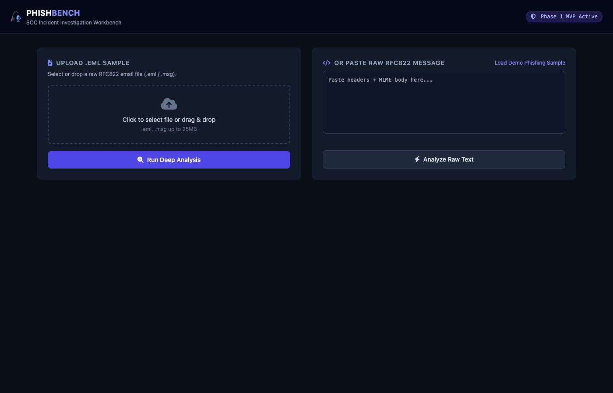
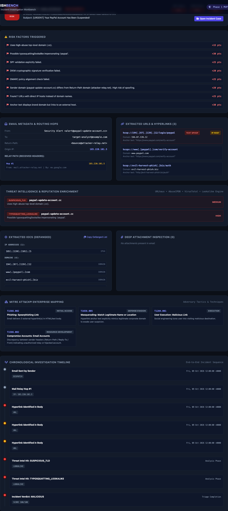
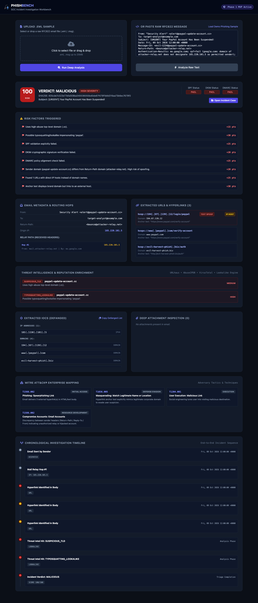

# 🎣 Phishing Incident Investigation Workbench

[](https://phishing-incident-investigation-wor.vercel.app)
[](https://www.python.org/)
[](https://fastapi.tiangolo.com/)
[](LICENSE)

An automated, full-stack **Security Operations Center (SOC) Investigation Workbench** designed to triage, analyze, and document suspicious phishing emails in seconds.

Instead of manually examining raw headers, tracing IP relay hops, validating SPF/DKIM/DMARC records, and copying malicious URLs into separate tabs, analysts can drop an email sample directly into PhishBench to receive an end-to-end forensic dossier.

🌐 **Live Application:** [https://phishing-incident-investigation-wor.vercel.app](https://phishing-incident-investigation-wor.vercel.app)

---

## 📸 Workbench Previews (Live Snapshots)

### 1. Investigation Dashboard Overview
The intuitive dark-themed SOC interface allowing analysts to upload raw `.eml` files or paste RFC 822 email text:



---

### 2. Live Forensic Triage & Threat Assessment
Real-time risk scoring, SPF/DKIM/DMARC authentication pills, brand typosquatting alerts, and one-click case actions:



---

### 3. Complete Incident Dossier & Chain of Custody
Relay hops inspection, anchor text spoofing analysis, MITRE ATT&CK® matrix mapping, defanged IOC tables, and a chronological incident timeline:



---

## ⚡ Core Capabilities & Features

### 🔍 1. Email Ingestion & Route Tracing
* **MIME & RFC 822 Decomposition:** Ingests raw `.eml` and `.msg` email files, parsing multipart text, HTML, and base64 attachments.
* **Chronological Relay Path:** Reads all `Received:` headers in reverse chronological order to trace the email's physical transit path from origin server to corporate gateway.
* **Authentication Verification:** Automatically parses **SPF**, **DKIM**, and **DMARC** validation records.
* **Sender Address Spoofing Detection:** Compares claimed `From:` headers against `Return-Path:` and `Reply-To:` addresses to flag impersonation.

---

### 🔗 2. Hyperlink & Anchor Text Spoofing Analysis
* **Anchor Text Spoofing Detection:** Flags attacks where the displayed text claims a trusted domain (e.g., `https://www.paypal.com/verify`) while the underlying HTML `href` links to an attacker-controlled IP or malicious host.
* **Direct IP Host Detection:** Highlights URLs directing users to raw IP addresses instead of registered domain names.
* **Automated Defanging:** Automatically defangs all URLs (`hxxp://...[.]...`), IPs, and domains to eliminate accidental execution risks.

---

### 🛡️ 3. Threat Intelligence & Typosquatting Engine
* **Offline Lookalike Detection:** Uses the **Levenshtein Distance Algorithm** to identify brand impersonation (PayPal, Microsoft, Google, Apple, Amazon, Banking, etc.) without relying on rate-limited external APIs.
* **Homograph & Punycode Alerts:** Detects Internationalized Domain Names (IDN homograph attacks via `xn--...`).
* **Suspicious TLD Filtering:** Flags high-abuse top-level domains (`.cc`, `.xyz`, `.top`, `.buzz`, `.tk`).
* **External Threat Intelligence Feeds:** Integrates with **URLhaus** (abuse.ch active malware feed), **AbuseIPDB**, and **VirusTotal**.

---

### 🔬 4. Deep Attachment Inspection
* **Magic Byte Classification:** Reads initial byte signatures (`MZ` for PE executables, `%PDF` for PDFs, `PK` for ZIP archives) independently of the file extension.
* **Disguised Executable Detection:** Flags executable binaries disguised as documents.
* **Double Extension Alerts:** Flags social-engineering tricks like `Invoice_2026.pdf.exe`.
* **Shannon Entropy Analysis:** Computes mathematical entropy ($0.0$ to $8.0$). Payloads exceeding $7.1$ are flagged as packed, encrypted, or compressed.

---

### 🎯 5. MITRE ATT&CK® Enterprise Mapping
Correlates observed indicators to official MITRE Enterprise Tactics & Techniques:
* `T1566.001`: Phishing: Spearphishing Attachment *(Initial Access)*
* `T1566.002`: Phishing: Spearphishing Link *(Initial Access)*
* `T1036.005`: Masquerading: Match Legitimate Name or Location *(Defense Evasion)*
* `T1586.002`: Compromise Accounts: Email Accounts *(Resource Development)*
* `T1204.001` & `T1204.002`: User Execution *(Execution)*
* `T1059`: Command and Scripting Interpreter *(Execution)*

---

### 📑 6. Case Management & Audit Reporting
* **Incident Case Creation:** Persists investigation results under tracked case references (`CASE-XXXXXXXX`).
* **Analyst Audit Trail:** Allows team members to log timestamped notes and sign off on verdicts (`MALICIOUS`, `SUSPICIOUS`, `BENIGN`).
* **Audit Report Generator:** Exports self-contained, standalone HTML reports complete with all forensic tables for compliance archiving and distribution to CSIRT/CERT teams.

---

## 🛠️ Tech Stack & Architecture

| Layer | Technologies |
|---|---|
| **Backend Framework** | [FastAPI](https://fastapi.tiangolo.com/) + [Uvicorn](https://www.uvicorn.org/) (Python 3.11 ASGI) |
| **Email Parsing** | Python `email` stdlib + [BeautifulSoup4](https://www.crummy.com/software/BeautifulSoup/) |
| **Threat Intelligence** | [httpx](https://www.python-httpx.org/) (AsyncClient) + [URLhaus](https://urlhaus.abuse.ch/) + [AbuseIPDB](https://www.abuseipdb.com/) + [VirusTotal](https://www.virustotal.com/) |
| **Algorithms** | Levenshtein Distance (Typosquatting) + Shannon Entropy (Payloads) |
| **Frontend UI** | Modern Responsive HTML5 / Vanilla JS + [Tailwind CSS](https://tailwindcss.com/) + [FontAwesome](https://fontawesome.com/) |
| **Deployment** | [Vercel Serverless Functions](https://vercel.com/) (`@vercel/python`) |

---

## 🚀 Getting Started Locally

### 1. Clone Repository & Setup Environment
```bash
git clone https://github.com/Shivangi-gupta-loo1/Phishing-Incident-Investigation-Workbench.git
cd Phishing-Incident-Investigation-Workbench

# Create virtual environment
python3 -m venv venv
source venv/bin/activate

# Install dependencies
pip install -r requirements.txt
```

### 2. Configure Threat Intel API Keys (Optional)
URLhaus and the Typosquatting engine run without any keys. To enable VirusTotal and AbuseIPDB:
```bash
export VIRUSTOTAL_API_KEY="your_api_key_here"
export ABUSEIPDB_API_KEY="your_api_key_here"
```

### 3. Run the Workbench
```bash
export PYTHONPATH=backend
uvicorn app.main:app --host 127.0.0.1 --port 8000 --reload
```
Open your browser and navigate to **`http://127.0.0.1:8000`**.

---

## 🧪 Running Automated Tests

Run the test suite with pytest:
```bash
source venv/bin/activate
PYTHONPATH=backend pytest backend/tests/ -v
```

---

## 📄 Project Documentation & Artifacts
A complete technical specification Word document is included in the root directory:
* [`Phishing_Investigation_Workbench_Documentation.docx`](Phishing_Investigation_Workbench_Documentation.docx)

---

## 👤 Author
* **Shivangi Gupta** — [GitHub Profile](https://github.com/Shivangi-gupta-loo1)
